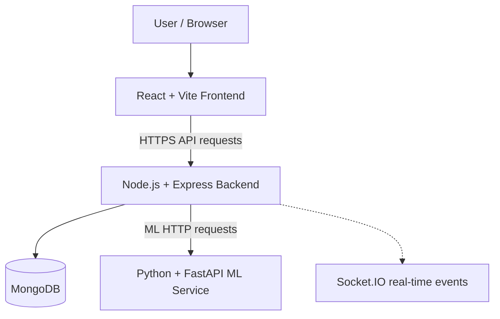

# Sentra

**Intelligent Sensor Monitoring, Anomaly Detection, and Drift Analysis**

Sentra is a full-stack web application designed to help users monitor sensor and asset data, investigate unusual readings, and build a clearer picture of sensor reliability. It combines a browser-based dashboard with a Node.js API and a Python machine-learning service intended for anomaly detection and drift analysis.

> **Project status:** The frontend is deployed on Vercel and the Node.js backend is deployed on Render. The backend has been observed starting successfully, but it may fall back to an in-memory MongoDB instance when a persistent database is unavailable. The ML service is not yet connected to the deployed backend. Authentication and end-to-end workflows should be verified before using this project with real users or data.

## Table of contents

- [Overview](#overview)
- [Goals](#goals)
- [Features](#features)
- [Architecture](#architecture)
- [Technology stack](#technology-stack)
- [Repository structure](#repository-structure)
- [Live demo](#live-demo)
- [Prerequisites](#prerequisites)
- [Run locally](#run-locally)
- [Environment variables](#environment-variables)
- [API and service checks](#api-and-service-checks)
- [Deployment](#deployment)
- [Data persistence](#data-persistence)
- [Security notes](#security-notes)
- [Troubleshooting](#troubleshooting)
- [Development workflow](#development-workflow)
- [Roadmap](#roadmap)
- [Contributing](#contributing)
- [License](#license)

## Overview

Sensor systems can produce noisy readings, unexpected changes, and false alarms. Sentra aims to provide a unified interface for reviewing sensor and asset information and, as the ML integration is completed, supporting anomaly detection and drift analysis.

The project is organized into three main application layers:

1. **Frontend:** A React dashboard for interacting with the application.
2. **Backend:** An Express API for application logic, authentication, data access, and real-time communication.
3. **Machine-learning service:** A Python/FastAPI service intended to provide model-backed analysis.

MongoDB is used as the application's data store through Mongoose. For a persistent deployment, configure a real MongoDB deployment instead of relying on an in-memory fallback.

## Goals

- Provide a single dashboard for sensor- and asset-related information.
- Make it easier to identify unusual sensor behavior.
- Support analysis of changes in sensor behavior over time.
- Separate user-interface, API, data, and ML responsibilities.
- Provide a deployable foundation that can be extended with additional models, data sources, and monitoring capabilities.

## Features

The repository contains the foundations for the following capabilities. Availability may depend on the current deployment configuration.

- **Web dashboard:** React-based user interface.
- **Backend API:** Express endpoints for application functionality.
- **Authentication flow:** Login-related frontend and backend code; verify the deployed login behavior before relying on it.
- **Sensor and asset data:** Mongoose models and seed scripts are present in the backend.
- **Real-time communication:** Socket.IO is included in the backend stack.
- **ML service foundation:** Python/FastAPI application intended for machine-learning operations.
- **Cloud deployment:** Frontend and backend have separate deployment targets.

> Do not assume every feature is production-ready just because its code exists. In particular, the deployed ML service, persistent database, and authentication behavior must be validated end to end.

## Architecture



### Component responsibilities

| Component | Responsibility | Technology |
|---|---|---|
| Frontend | Dashboard, user interaction, API requests | React, Vite, Axios |
| Backend | API routes, application logic, authentication, real-time communication | Node.js, Express, Socket.IO |
| Data layer | Store and retrieve application data | MongoDB, Mongoose |
| ML service | Intended model inference and sensor analysis | Python, FastAPI, scikit-learn |
| Hosting | Build and serve the web app and API | Vercel, Render |
| Source control | Code hosting and version history | Git, GitHub |

## Technology stack

### Frontend
- React 19
- Vite
- JavaScript
- Axios

### Backend
- Node.js
- Express.js
- Socket.IO
- Mongoose

### Machine learning
- Python
- FastAPI
- scikit-learn

The exact Python packages and model capabilities depend on the files in `ml/` and its requirements file.

### Data storage
- MongoDB
- Mongoose ODM
- An in-memory MongoDB fallback may be used by the backend if an external database cannot be reached. This is suitable only for temporary development/demo scenarios because its data may disappear when the process restarts.

### Deployment and tooling
- Vercel — frontend
- Render — backend; ML hosting can be added separately
- Git and GitHub — version control and repository hosting

## Repository structure

The repository is organized approximately as follows. Check the actual directory contents if files have been renamed or moved.

```text
sentra/
├── frontend/          # React + Vite application
│   └── src/            # UI and API client code
├── backend/           # Node.js + Express API
│   ├── ...             # Routes, models, configuration, seed scripts
│   └── package.json
├── ml/                # Python ML / FastAPI service
├── docker-compose.yml # Local multi-service setup, if configured
├── render.yaml        # Render deployment configuration, if configured
└── README.md
```

## Live demo

- **Frontend:** https://sentra-seven-pi.vercel.app
- **Backend:** https://sentra-4qzx.onrender.com

The backend has responded to a ping/health request during deployment checks. Render free services may take time to wake up after inactivity.

**Current deployment caveats**
- The frontend's `VITE_API_URL` should be configured as `https://sentra-4qzx.onrender.com` in Vercel, then the frontend must be redeployed.
- The backend has reported using an in-memory MongoDB fallback. Configure persistent MongoDB for reliable data retention.
- The ML dependency has reported connection refused at `localhost:8000`. A separately deployed ML service and correct backend `ML_SERVICE_URL` are needed before ML-backed features can be considered live.
- Confirm login, API requests, and the main user workflows in the deployed site before presenting them as fully operational.

## Prerequisites

Install the following before running Sentra locally:

- Git
- Node.js and npm (use a Node.js version compatible with the packages in the repository)
- Python 3.10 or a version compatible with `ml/requirements.txt`
- pip and Python virtual-environment support
- MongoDB, or the repository's supported in-memory fallback for temporary development

Optional:
- Docker and Docker Compose, if you prefer the repository's container setup.

## Run locally

Run each service in its own terminal from the repository root.

### 1. Clone the repository

```bash
git clone https://github.com/shubhampawar721919-prog/sentra.git
cd sentra
```

### 2. Start the ML service

```bash
cd ml
python -m venv .venv
source .venv/bin/activate
python -m pip install --upgrade pip
pip install -r requirements.txt
uvicorn app.main:app --host 0.0.0.0 --port 8000 --reload
```

If the entry point or module path differs in your current checkout, inspect `ml/` and use the FastAPI app module defined by the repository. Keep the ML service running in this terminal.

### 3. Start the backend

Open another terminal:

```bash
cd sentra/backend
npm install
```

Set the backend environment variables described below, then start the server:

```bash
npm run dev
```

If the project does not define a `dev` script, inspect `backend/package.json` and use the available development/start script. For a production-style local start, the repository may provide:

```bash
npm start
```

The backend must be configured to reach your MongoDB instance and ML service. When running locally, the ML service is typically available at `http://127.0.0.1:8000`.

### 4. Start the frontend

Open a third terminal:

```bash
cd sentra/frontend
npm install
```

Create a local environment file named `.env.local` inside `frontend/`:

```dotenv
VITE_API_URL=http://localhost:5001
```

This value assumes the backend listens on port `5001`, which is the frontend's fallback default in the current code. If your backend uses a different port, update the value to match it.

Start Vite:

```bash
npm run dev
```

Open the local URL printed by Vite in your terminal (commonly `http://localhost:5173`).

### 5. Verify the services

- Open the frontend and confirm it loads.
- Check the backend's documented ping/health endpoint.
- Inspect browser developer tools if API requests fail.
- Verify that the backend can reach MongoDB.
- Verify that the backend can reach the ML service if ML features are being tested.

The exact API routes can be found in the backend route files. Do not assume an endpoint exists unless it is defined by the current code.

## Environment variables

Environment variable names are application-specific. Check the backend configuration files and `backend/.env.example` if one exists before adding variables. Never commit secrets.

### Frontend (`frontend/.env.local`)

| Variable | Purpose | Example |
|---|---|---|
| `VITE_API_URL` | Root URL for the backend API | `http://localhost:5001` locally; `https://sentra-4qzx.onrender.com` on Vercel |

The frontend's API client appends `/api` when needed. Therefore, set the value to the backend root URL, not to a URL that already includes `/api`, unless the current API client code has changed.

Vite embeds `VITE_` variables into client-side code. **Never store passwords, private API keys, database credentials, or other secrets in frontend variables.**

### Backend

Use the exact names read by the backend code. Common deployment settings for this architecture include:

| Variable | Purpose | Example / guidance |
|---|---|---|
| `PORT` | HTTP server port | Use the hosting provider's assigned port where required |
| `FRONTEND_URL` | Allowed frontend origin for CORS | `https://sentra-seven-pi.vercel.app` |
| `MONGODB_URI` | Persistent MongoDB connection string | Use a private connection string from MongoDB Atlas or another MongoDB host |
| `ML_SERVICE_URL` | Base URL of the ML service | Local: `http://127.0.0.1:8000`; production: the deployed ML service's HTTPS URL |

These are configuration examples, not a guarantee that every variable is read by the current code. Check the source before setting or renaming variables. If the code expects a different MongoDB variable name, use the name it actually reads.

### ML service

Check `ml/` for any required settings. If the service uses a port variable, configure it according to its entry point and hosting provider. Ensure the backend's `ML_SERVICE_URL` points to the ML service's **public service URL** in production, not `localhost` or `127.0.0.1`.

## API and service checks

The backend exposes ping/health functionality in the current deployment. Use the endpoint paths defined by the backend source; a typical deployment may expose:

```text
https://sentra-4qzx.onrender.com/api/ping
```

If this route exists in your deployed version, a successful response indicates the backend can respond to the request. It does not, by itself, prove that authentication, persistent storage, or ML inference is working.

For troubleshooting, check:
1. Browser DevTools → **Network** for the failing request and HTTP status.
2. Vercel deployment logs for frontend build errors.
3. Render backend logs for API, CORS, database, and ML connection errors.
4. ML service logs for startup or inference failures.

## Deployment

### Frontend on Vercel

1. Import the GitHub repository into Vercel.
2. Set the project root directory to `frontend/`.
3. Use the frontend's normal install/build commands. The standard Vite build command is `npm run build`.
4. Add the production environment variable:

   ```dotenv
   VITE_API_URL=https://sentra-4qzx.onrender.com
   ```

5. Redeploy after changing environment variables.
6. Open the deployed website and verify the login flow and API calls.

If Vercel is configured to build from the repository root instead of `frontend/`, update the root directory or configure the build and output settings to match the repository.

### Backend on Render

1. Create a Web Service connected to the GitHub repository.
2. Set the root directory to `backend/`.
3. Configure the build command using the project's package scripts/dependencies (commonly `npm install`).
4. Configure the start command according to `backend/package.json` (commonly `npm start`).
5. Set the environment variables the backend actually uses, including the frontend origin and persistent database URI.
6. Deploy and inspect the logs until the server reports it is listening and its database connection is healthy.

### ML service hosting

Deploy the Python service as a separate web service or use a container setup that runs it. Then:

1. Confirm the service starts and its health endpoint works.
2. Set the backend's `ML_SERVICE_URL` to the deployed ML service's reachable HTTPS base URL.
3. Redeploy/restart the backend.
4. Confirm the backend no longer reports connection refused to `localhost:8000`.
5. Test a real ML request and inspect both services' logs.

Do not use `http://127.0.0.1:8000` as the production ML URL when the ML service runs in a separate Render service: localhost refers to the backend's own container.

## Data persistence

An in-memory MongoDB fallback is **not persistent storage**. Data written to it can disappear when the backend process restarts or the hosting platform replaces the instance.

For a reliable deployment:

1. Provision MongoDB Atlas or another persistent MongoDB host.
2. Create a database user with only the permissions required by the application.
3. Configure network access securely for the deployment environment.
4. Set the database URI using the exact environment variable expected by the backend code.
5. Restart/redeploy the backend and confirm logs show a connection to the intended persistent database.
6. Test that data remains after a backend restart.

Never commit a database connection string to GitHub.

## Security notes

Before using Sentra with real users or production data:

- Verify that login is enforced on protected pages and API routes.
- Do not treat hiding a login screen in the frontend as access control; enforce authorization on the backend.
- Remove or disable demo-login shortcuts before production if they are not intended.
- Use secure password hashing and proper session/token validation, as supported by the codebase.
- Restrict CORS to trusted origins rather than allowing every origin by default.
- Store secrets only in hosting-provider environment variables or a secret manager.
- Use HTTPS for deployed services.
- Validate request input and apply appropriate authorization checks to sensitive operations.
- Add rate limiting and safe error handling to public authentication endpoints.
- Avoid storing sensitive tokens in browser storage unless the security trade-offs are understood.
- Review dependency audit reports and update vulnerable packages carefully.
- Use persistent database storage and backups for important data.

This README is not a security certification. Review the current implementation before production use.

## Troubleshooting

### The frontend loads, but API requests fail

- Confirm `VITE_API_URL` is set in Vercel to `https://sentra-4qzx.onrender.com`.
- Redeploy the frontend after changing the variable.
- Open browser DevTools → Network and inspect the failing URL and status.
- Check the Render service logs and CORS configuration.

### Login is skipped or the dashboard opens unexpectedly

- Test in a private/incognito browser window.
- Clear site data for the deployed frontend and try again.
- Review frontend authentication state, route guards, demo-login shortcuts, and session restoration.
- Verify protected backend endpoints require valid authentication; do not rely on frontend routing alone.

### Login fails

- Inspect the login request in DevTools → Network.
- `401` commonly indicates invalid credentials or rejected authentication.
- `404` can indicate an incorrect API route.
- `500` indicates a server-side failure; inspect Render logs.
- A browser CORS error suggests the backend's allowed origin does not match the frontend origin.
- Confirm the expected user exists in the database that the deployed backend is actually using.

### Data disappears after redeployment or restart

The backend may be using its in-memory MongoDB fallback. Configure a persistent MongoDB instance and verify that the backend connects to it.

### ML status is offline or connection is refused

- Ensure the ML service is running.
- Locally, check that the app is listening on the expected port.
- In production, set `ML_SERVICE_URL` to the separate ML service's reachable URL.
- Restart/redeploy the backend and check its logs.
- Test the ML service directly before debugging the backend integration.

### Render service takes a long time to respond

A free service may need to wake from inactivity. Wait for the service to start, then retry. Check Render logs if it remains unavailable.

## Development workflow

1. Create a feature branch.
2. Make a focused change in the relevant service.
3. Install dependencies and run that service locally.
4. Test the affected UI/API/ML flow.
5. Review environment variables and ensure secrets are not staged.
6. Commit and push your branch.
7. Validate the deployed build and review service logs.

Example:

```bash
git checkout -b feature/your-change
git status
git add .
git commit -m "Describe your change"
git push -u origin feature/your-change
```

Review `git status` before committing and do not commit `.env` files containing secrets.

## Roadmap

Potential next steps for making the deployment more complete:

- [ ] Verify login and protected-route behavior end to end.
- [ ] Configure persistent MongoDB and test data retention.
- [ ] Deploy the ML service and connect it through `ML_SERVICE_URL`.
- [ ] Test anomaly detection and drift-analysis flows with representative data.
- [ ] Add automated frontend/backend tests.
- [ ] Add consistent health checks and structured logging.
- [ ] Document confirmed API routes and request/response examples.
- [ ] Add monitoring, backups, and production security hardening.

## Contributing

Contributions and suggestions are welcome. For larger changes, open an issue first to discuss the approach. Keep pull requests focused, include relevant test steps, and document any new environment variables.

## Contributions

specialized ideation from CRUD Crew Polaris 
Special contribution from https://github.com/tanushreegulve-arch
& https://github.com/DEVA0917
## License

No license is specified here. Add a `LICENSE` file and update this section before inviting reuse or redistribution. Without an explicit license, users generally do not receive permission to reuse, modify, or redistribute the project beyond rights granted by applicable law.
